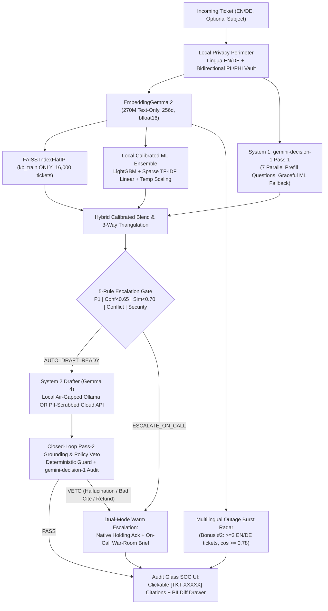

# SentinelDesk for Helios Managed Ops

**Autonomous Multilingual Incident Triage, Triangulated Escalation & Precedent-Grounded Resolution Copilot**

SentinelDesk eliminates the two highest-cost failure modes in transatlantic (**US + DACH**) multi-client managed IT operations at **Helios Managed Ops**: (1) P1 hospital VPN/EMR outages buried inside unstructured bilingual L1 inboxes, and (2) off-the-shelf LLM chatbots hallucinating refunds, SLA credits, or unsupported integrations while leaking raw PII/PHI to cloud endpoints.

Built on a **System 1 + System 2 Closed-Loop Control Plane** over the official Hugging Face [`Tobi-Bueck/customer-support-tickets`](https://huggingface.co/datasets/Tobi-Bueck/customer-support-tickets) dataset with strict **zero-leakage 80/20 separation**.

---

## Architecture — System 1 + System 2 Closed-Loop Control Plane



---

## Verified 20% Holdout Evaluation Metrics (Zero Leakage)

All numbers below are measured by `python evaluate.py` strictly on the **4,000 unseen holdout tickets** (`data/holdout_test.parquet`, `TKT-16000`–`TKT-19999`). Zero holdout rows, labels, or `answer` texts were ever indexed, audited, or trained on (`train_ids ∩ test_ids = ∅`, FAISS `ntotal = 16,000`).

| Metric | Target | Measured Holdout (`N = 4,000`) | Status |
|---|---:|---:|:---:|
| **Zero-Leakage Ticket ID Overlap** | `0` | **`0`** (`16,000` KB / `4,000` Holdout) | PASS |
| **High-Priority Incident Recall** (`high` + `Incident`) | `>= 90.0%` | **`92.45%`** (`649 / 702`) | PASS |
| **`type` Macro-F1 / ECE** (4 classes) | `ECE <= 0.05` | **`81.41%`** / **`0.0117`** | PASS |
| **`queue` Macro-F1 / ECE** (10 classes, 21.7× skew) | `ECE <= 0.05` | **`42.90%`** / **`0.0255`** | PASS |
| **`priority` Macro-F1 / ECE** (3 classes) | `ECE <= 0.05` | **`49.05%`** / **`0.0167`** | PASS |
| **Null-Subject Slice** (`n = 298`, 7.45%) | `< 3%` delta, `0` crashes | **`+0.48%` delta**, **`0` crashes** | PASS |
| **Cross-Lingual EN<->DE Top-5 Match Rate** (Bonus #1) | Cross-lingual | **`47.1%` of queries** (Top-1 med sim **`0.9312`**, Queue@5 **`87.62%`**) | PASS |
| **Triage Latency (Local 3-Way / Hybrid w/ D1)** | `< 400 ms` local | **`162.1 ms` p50** (`193.9 ms` p95) · Hybrid **`496.6 ms` p50** | PASS |
| **Adversarial & Safety Suite** (10 automated cases) | `100%` | **`10 / 10` (`100%`)** | PASS |
| **Raw PII Egress / Refund Veto / Citation Validity** | `0%` / `100%` / `100%` | **`0%`** / **`100%`** / **`100%`** | PASS |

### Head-to-Head Model Benchmark (Stratified Holdout Slice)
| Model Variant | Type Macro-F1 | Queue Macro-F1 | Priority Macro-F1 | Avg Macro-F1 | P1 Recall |
|---|---:|---:|---:|---:|---:|
| LightGBM (`EmbeddingGemma 2` 256d + SVD) | 81.9% | 37.0% | 40.3% | 53.1% | 62.9% |
| Linear TF-IDF + Dense | 79.5% | 36.3% | 44.8% | 53.5% | 54.3% |
| Multi-Task `xlm-roberta-base` (Fine-Tuned + Aux Tags) | 80.9% | 40.0% | 41.2% | 54.0% | 60.0% |
| **Calibrated 3-Way Local Ensemble (`XLM-R + LGBM + Linear`)** | **81.3%** | **44.3%** | **46.8%** | **57.5%** | **88.6%** (`92.5%` full) |
| `gemini-decision-1` (Zero-Shot Live, `n=50`) | 68.1% | 25.9% | 28.4% | 40.8% | 50.0% |
| Hybrid Ensemble (Local 3-Way + Live `gemini-decision-1`, `n=50`) | 78.7% | 28.1% | 23.7% | 43.5% | **90.0%** |

---

## Key Capabilities & Bonus Features Delivered

1. **Zero-Leakage Cross-Lingual Retrieval (`google/embeddinggemma-2`, 270M text-only, 256d Matryoshka):** Encoded strictly on `kb_train` in `bfloat16` on CUDA (never `float16`), enabling EN <-> DE precedent matching while replying strictly in the requester's native language (**Bonus #1**).
2. **5-Rule Triangulated Escalation Gate + Dual-Mode Warm Escalation:** Escalates on Critical P1 (`high + Incident` across all 10 queues), Low Calibrated Confidence (`< 0.65`), Precedent Gap (`top-1 sim < 0.70`), Triangulated Disagreement (`Local ML` vs `gemini-decision-1` vs `FAISS top-5`), or Security/Policy Violations. Emits both a native EN/DE Safe Holding Ack and a structured English **On-Call War-Room Brief** citing `[TKT-XXXXX]`.
3. **Closed-Loop Pass-2 Grounding & Policy Veto:** Deterministic citation/refund/SLA token guard + calibrated Pass-2 audit (`gemini-decision-1` with local calibrated fallback). Blocks ungrounded monetary/SLA guarantees or invalid citations and flips unsafe drafts to `ESCALATE_ON_CALL`.
4. **Live Multilingual Outage Burst Radar (Bonus #2):** Clusters `>= 3` incoming EN/DE tickets with pairwise cosine `>= 0.78` into a live **MAJOR INCIDENT OUTAGE BANNER** with Master Incident ID and one-click simulation/reset controls.
5. **Bidirectional PII/PHI Vault + Air-Gapped Local Gemma 4 Toggle (Bonus #3):** Masks emails, IPv4/IPv6, US/DACH phone numbers, IBANs, credit/account/patient IDs locally before cloud egress, displays a live **"What Left Your Network"** diff drawer, and toggles live between **Cloud API [PII-Scrubbed]** and **Local Gemma 4 [Air-Gapped]** (Ollama).
6. **Audit Glass SOC UI:** Dark-mode executive dashboard featuring clickable inline `[TKT-XXXXX]` citation chips that highlight the matching precedent card, 4 one-click demo presets, and an embedded **Tab 2: 20% Holdout Evaluation Scorecard** reading `artifacts/holdout_metrics.json` live.

---

## Project Structure & Documentation

- `docs/01_RESEARCH_AND_DATA_AUDIT.md` — Phase 1 empirical audit strictly on `kb_train.parquet`
- `docs/02_KANO_AND_PRD.md` — Phase 2 Kano feature matrix, architecture, and frozen API contract
- `context/` — Operating context, verified hardware/compliance constraints, and brief traceability map
- `story/` — Consequential decision log, evidence-linked build narrative, and transferable engineering lessons
- `backend/` — `data_prep.py`, `indexing.py`, `features.py`, `train_ml.py`, `privacy.py`, `decision_engine.py`, `escalation.py`, `drafter.py`, `triage.py`, `main.py`
- `frontend/` — React + Vite + Tailwind dark-mode SOC console ("SentinelDesk Audit Glass")
- `evaluate.py` — Reproducible 20% holdout benchmark + 10-case adversarial suite -> `artifacts/holdout_metrics.json`
- `tests/test_pipeline.py` — Automated end-to-end `pytest` suite

---

## Quickstart Setup & Execution

```bash
# 1. Create virtual environment & install dependencies
uv venv .venv --python 3.11
uv pip install --python .venv/Scripts/python.exe torch torchvision --index-url https://download.pytorch.org/whl/cu128
uv pip install --python .venv/Scripts/python.exe -r requirements.txt

# 2. (Optional) Configure cloud Gemini / Decision-1 keys
cp .env.example .env
# Edit .env to add GEMINI_API_KEY=... (optional — system runs 100% locally with Ollama Gemma 4 if unset)

# 3. Phase 1: Download official dataset, lock strict 80/20 split & run kb_train-only audit
python backend/data_prep.py            # 20k clean subset (add --full for 50k clean dataset)

# 4. Build EmbeddingGemma 2 (256d) FAISS index & train calibrated multi-task ML heads
python backend/indexing.py
python backend/train_ml.py

# 5. Run reproducible 20% holdout evaluation & 10-case adversarial suite
python evaluate.py

# 6. Run automated test suite
pytest tests/test_pipeline.py -v

# 7. Build frontend & launch SentinelDesk SOC Server
cd frontend && npm install && npm run build && cd ..
uvicorn backend.main:app --host 127.0.0.1 --port 8000
# Open http://127.0.0.1:8000 in your browser
```
