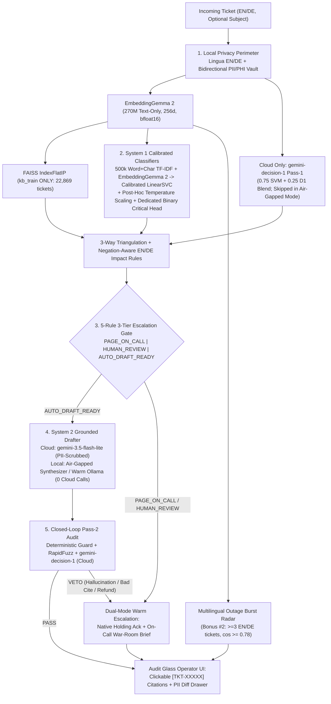

# SentinelDesk for Helios Managed Ops

**Autonomous Multilingual Incident Triage, Triangulated Escalation & Precedent-Grounded Resolution Copilot**

> **Live Web UI:** [https://fredess74.github.io/sentineldesk-helios-ops/](https://fredess74.github.io/sentineldesk-helios-ops/)  
> **Architecture, Cloud vs. Local & Business Alignment Story:** [`story/03_ARCHITECTURE_AND_BUSINESS_FIT.md`](story/03_ARCHITECTURE_AND_BUSINESS_FIT.md) · [`story/00_DECISION_LOG.md`](story/00_DECISION_LOG.md)

SentinelDesk eliminates the two highest-cost failure modes in transatlantic (**US Austin + DACH Munich**) multi-client managed IT operations at **Helios Managed Ops**: (1) P1 hospital VPN/EMR outages buried inside unstructured bilingual L1 inboxes across 10 queues, and (2) off-the-shelf LLM chatbots hallucinating refunds, SLA credits, or unsupported integrations while leaking raw PII/PHI to cloud endpoints.

Built on a streamlined **System 1 + System 2 Closed-Loop Control Plane** over the official Hugging Face [`Tobi-Bueck/customer-support-tickets`](https://huggingface.co/datasets/Tobi-Bueck/customer-support-tickets) (`28,587`-row clean 10-queue archive) with strict **duplicate-text grouped zero-leakage 80/20 separation** (`splits/split_assignment.csv`).

---

## Architecture — Streamlined System 1 + System 2 Control Plane (v3)



---

## Cloud · PII-Scrubbed vs. Local · Air-Gapped (Two Real Compliance Tiers)

SentinelDesk cleanly separates Helios Managed Ops's two commercial operating tiers — verifiable directly from the UI mode badge (`Cloud Hybrid · 3 API` vs. `Air-Gapped · 0 Cloud Calls`):

| Dimension | `Cloud · PII-Scrubbed` (Commercial Tier) | `Local · Air-Gapped` (Sovereign / HIPAA-Strict Tier) |
|---|---|---|
| **External Cloud Calls** | `1–3` PII-scrubbed Gemini API calls (Vault scrubs raw PII first) | **Strictly `0` cloud calls** (`cloud_calls_made == 0`) |
| **System 1 Triage** | Hybrid `0.75` Calibrated SVM + `0.25` live `gemini-decision-1` | **100% On-Device** Calibrated SVM + `EmbeddingGemma 2` + local impact rules |
| **System 2 Drafter** | Live **`gemini-3.5-flash-lite`** (fluent native EN/DE, cited) | **100% On-Device** Precedent Synthesizer (or warm Ollama if pre-loaded) |
| **Pass-2 Grounding Audit** | Live **`gemini-decision-1` Pass-2** + `RapidFuzz` + Policy Guard | **100% On-Device** `RapidFuzz` Lexical Grounding + Policy Guard |
| **Typical E2E Latency** | `~1.5 – 2.2 s` | **`~70 – 160 ms`** (zero network dependency) |

---

## Verified 20% Holdout Evaluation Metrics (Zero Leakage, N = 5,718)

All numbers below are measured by `python evaluate.py` strictly on the **5,718 unseen holdout tickets** (`data/holdout_test.parquet`, duplicate-text grouped via `StratifiedGroupKFold(n_splits=5)`). Zero holdout IDs, duplicate texts, labels, or `answer` strings were ever indexed, audited, or trained on (`train_ids ∩ test_ids = ∅`, FAISS `ntotal = 22,869`).

| Metric | Target | v2 (20k XLM-R+LGBM) | **v3 Unified (28.5k SVM+EmbeddingGemma 2)** | Status |
|---|---:|---:|---:|:---:|
| **Zero-Leakage Overlap** | `0` IDs & `0` duplicate texts | 16k / 4k (`0` IDs) | **22,869 / 5,718 (`0` IDs & `0` dup texts)** | PASS |
| **`type` Macro-F1 / ECE** (4 classes) | `ECE <= 0.05` | 81.41% / 0.0117 | **`86.22%` / `0.0058`** (`tfidf_svm`) | PASS |
| **`queue` Macro-F1 / ECE** (10 skewed queues) | `ECE <= 0.05` | 42.90% / 0.0255 | **`55.43%` / `0.0424`** (`combo_svm`) | PASS |
| **`priority` Macro-F1 / ECE** (3 classes) | `ECE <= 0.05` | 49.05% / 0.0167 | **`58.08%` / `0.0167`** (`combo_svm`) | PASS |
| **Overall Mean Macro-F1** | Maximize imbalanced F1 | 57.79% | **`66.58%`** (**`+8.79 pts`**) | PASS |
| **High-Priority Incident Recall** (`high` + `Incident`) | `>= 90.0%` | 92.45% | **`91.59%`** (`904 / 987` · `30.9%` non-P1) | PASS |
| **Null-Subject Slice** (`n = 785`, 13.73%) | `0` crashes | 0 crashes | **`0` crashes** (null-subject beats non-null) | PASS |
| **Cross-Lingual EN↔DE Top-5 Match Rate** (Bonus #1) | Cross-lingual | 47.1% (Queue@5 87.6%) | **`52.47%`** (Top-1 med **`0.945`**, Queue@5 **`91.33%`**) | PASS |
| **Local Triage Latency (p50 / p95)** | `< 400 ms` local | 162.1 ms / 193.9 ms | **`142.6 ms` / `159.0 ms`** (Hybrid: `472.1 ms`) | PASS |
| **Adversarial & Safety Suite** (10 automated cases) | `100%` | 10 / 10 | **`10 / 10` (`100%`)** · `0%` PII leak · `100%` Veto | PASS |

### Head-to-Head Model Selection (Internal `kb_train` Val & Live `gemini-decision-1` Slice)
- **`type`:** `tfidf_svm` (`86.21%`) vs `combo_svm` (`86.10%`) vs `emb_lr` (`80.04%`)
- **`queue` (10 classes):** **`combo_svm` (`54.82%` val / `55.43%` holdout)** beat `tfidf_svm` (`54.78%`) and `emb_lr` (`26.78%`)
- **`priority`:** **`combo_svm` (`59.69%` val / `58.08%` holdout)** beat `tfidf_svm` (`58.97%`, **`+0.72 pts`**) and `emb_lr` (`41.87%`)
- **`critical` (Dedicated P1 Binary Head):** `tfidf_svm` AP **`0.6915`** (`combo_svm` `0.6880`)
- **Live Cloud Benchmark (`n = 50` stratified slice):** Zero-shot `gemini-decision-1` alone scored `43.0%` Avg Macro-F1 (`36.4%` P1 recall), whereas **Cloud Hybrid (`0.75 SVM + 0.25 D1`)** achieved **`62.3%` Avg Macro-F1** (`Type 82.2%`, `Queue 47.0%`, `Priority 57.6%`) and **`90.9%` P1 recall** (`472.1 ms` p50).

---

## Key Capabilities & Bonus Features Delivered

1. **Zero-Leakage Cross-Lingual Retrieval (`google/embeddinggemma-2`, 270M text-only, 256d Matryoshka):** Encoded strictly on `22,869 kb_train` docs in `bfloat16` on CUDA (never `float16`), achieving **52.47%** cross-lingual EN↔DE retrieval and **91.33%** Same-Queue@5 while replying strictly in the requester's native language (**Bonus #1**).
2. **5-Rule 3-Tier Escalation Gate + Dual-Mode Warm Escalation:** Distinguishes **`PAGE_ON_CALL`** (urgent P1 `critical` detector + negation-checked clinical/outage/security impact + prompt injection) from **`HUMAN_REVIEW`** (low calibrated confidence `< 0.65`, OOD similarity `< 0.70`, model disagreement, unsupported refund/SLA demand) and **`AUTO_DRAFT_READY`**. Escalations always emit a native EN/DE Safe Holding Ack + English **On-Call War-Room Brief** citing `[TKT-XXXXX]`.
3. **Closed-Loop Pass-2 Grounding & Policy Veto:** Deterministic citation/refund/SLA token guard + **`RapidFuzz`** sentence-level lexical grounding + calibrated Pass-2 audit (`gemini-decision-1` in Cloud mode / local auditor in Air-Gapped mode). Blocks ungrounded monetary/SLA guarantees or invalid citations and flips unsafe drafts to `HUMAN_REVIEW`.
4. **Live Multilingual Outage Burst Radar (Bonus #2):** Clusters `>= 3` incoming EN/DE tickets with pairwise cosine `>= 0.78` into a live **MAJOR INCIDENT OUTAGE BANNER** (`MIR-...`) with one-click simulation/reset controls.
5. **Bidirectional PII/PHI Vault + Strict Air-Gapped Local Mode (Bonus #3):** Masks emails, IPv4/IPv6, US/DACH phone numbers, IBANs, credit/account/patient IDs locally before cloud egress, renders a live **"What Left Your Network"** diff drawer, and toggles cleanly between **Cloud · PII-Scrubbed** and **Local · Air-Gapped (`0 Cloud Calls`)**.
6. **Clean Executive Operator Console:** Minimal dark-mode React/Vite UI featuring clickable inline `[TKT-XXXXX]` citation chips, 4 one-click demo presets, and an embedded **Holdout Evaluation** tab synced live with `artifacts/holdout_metrics.json`.

---

## Project Structure & History (`story/`)

- `story/03_ARCHITECTURE_AND_BUSINESS_FIT.md` — **Start here for presentation & business rationale:** simplified v3 architecture, Cloud vs. Air-Gapped table, Helios Managed Ops P&L/SLA mapping, and 5-minute demo flow
- `story/00_DECISION_LOG.md` — Consequential engineering decisions (`DEC-001` through `DEC-008`) including v2 -> v3 simplification
- `story/01_BUILD_NARRATIVE.md` — Evidence-linked end-to-end build evolution and verified metrics
- `story/02_LESSONS_AND_TRADEOFFS.md` — Transferable ML & production lessons
- `docs/01_RESEARCH_AND_DATA_AUDIT.md` — Phase 1 empirical audit strictly on `22,869 kb_train` tickets
- `docs/02_KANO_AND_PRD.md` — Phase 2 Kano feature matrix and frozen API contract
- `splits/split_assignment.csv` — Reproducible duplicate-grouped 80/20 `ticket_id -> split` ledger
- `backend/` — `data_prep.py`, `indexing.py`, `features.py`, `train_ml.py`, `privacy.py`, `decision_engine.py`, `escalation.py`, `drafter.py`, `triage.py`, `main.py`
- `frontend/` — React + Vite + Tailwind operator dashboard (auto-deployed to GitHub Pages via `.github/workflows/deploy-pages.yml`)
- `evaluate.py` & `tests/test_pipeline.py` — Reproducible 20% holdout benchmark + automated `pytest` verification

---

## Quickstart Setup & Execution

```bash
# 1. Create virtual environment & install dependencies
uv venv .venv --python 3.11
uv pip install --python .venv/Scripts/python.exe torch torchvision --index-url https://download.pytorch.org/whl/cu128
uv pip install --python .venv/Scripts/python.exe -r requirements.txt

# 2. (Optional) Configure cloud Gemini / Decision-1 keys
cp .env.example .env
# Edit .env to add GEMINI_API_KEY=... (optional — Local Air-Gapped mode runs with 0 cloud calls if unset)

# 3. Phase 1: Download official 28.5k clean dataset, lock duplicate-grouped 80/20 split & run kb_train-only audit
python backend/data_prep.py            # Official 28,587-row clean CSV (add --20k for smaller 20k subset)

# 4. Build EmbeddingGemma 2 (256d) FAISS index & train calibrated LinearSVC + critical models (~3.4 min)
python backend/indexing.py
python backend/train_ml.py

# 5. Run reproducible 20% holdout evaluation (5,718 unseen tickets) & 10-case adversarial suite
python evaluate.py

# 6. Run automated test suite
pytest tests/test_pipeline.py -v

# 7. Build frontend & launch SentinelDesk Server
cd frontend && npm install && npm run build && cd ..
uvicorn backend.main:app --host 127.0.0.1 --port 8000
# Open http://127.0.0.1:8000 in your browser
```
