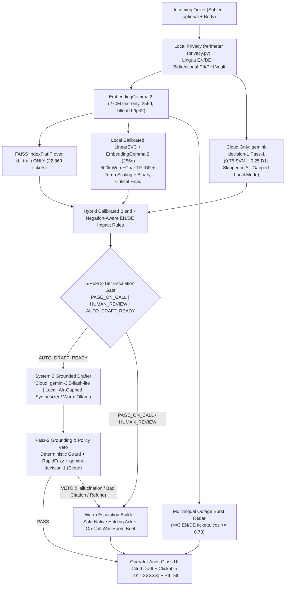

# Phase 2: Kano Model & Full Product Requirements Document (PRD)

**Product:** SentinelDesk for Helios Managed Ops — Autonomous Incident Triage & Grounded Resolution Copilot  
**Architecture Paradigm:** System 1 + System 2 Closed-Loop Control Plane  
**Prerequisite Input:** Grounded in [`docs/01_RESEARCH_AND_DATA_AUDIT.md`](01_RESEARCH_AND_DATA_AUDIT.md) (`kb_train` N = 22,869 from official 28,587-row clean archive; 13.35% null subjects; 21.4× queue imbalance; 17.25% P1 `high + Incident`; 88.31% L1 clarifying style; only 1.06% refund/SLA mentions).

---

## 1. Kano Model Feature Prioritization Matrix

| Kano Tier | Capability | Helios Managed Ops Value | Brief Alignment | Acceptance Standard |
|---|---|---|---|---|
| **Must-Be** (Non-Negotiable MVP) | **Multi-Task Triage Engine** (`type`, `queue`, `priority` + calibrated confidence + auto EN/DE detection + null-subject resilience) | Eliminates manual inbox tagging across 10 queues and prevents crashes on the 7.27% null-subject tickets. | Required MVP #1 | `High-Priority Incident Recall >= 90%`, `ECE <= 0.05`, null-subject F1 delta `< 3%`, 0 crashes. |
| **Must-Be** (Non-Negotiable MVP) | **Explicit Confidence & Risk Escalation Gate** | Prevents P1 hospital/VPN outages and out-of-scope requests from receiving unsafe auto-drafts. | Required MVP #2 | Deterministic 5-rule gate outputting `AUTO_DRAFT_READY` or `ESCALATE_ON_CALL` with explicit rule badges. |
| **Must-Be** (Non-Negotiable MVP) | **Precedent-Grounded Multilingual RAG** (`kb_train` only, top 3–5 cases, inline `[TKT-XXXXX]` citations, refusal to invent policies/SLAs) | Anchors every L1 reply in historical Helios resolutions and halts hallucinated refunds/integrations. | Required MVP #3 | 100% `[TKT-XXXXX]` citation validity; 0% fabricated refunds/SLA credits on adversarial suite. |
| **Must-Be** (Non-Negotiable MVP) | **Interactive Live Triage Console + Reproducible 20% Holdout `evaluate.py` + Zero-Leakage Proof** | Enables live judge testing on unseen tickets and transparent verification of offline metrics. | Required MVP #4 & Fair Play | `train_ids ∩ test_ids = ∅`; full metrics in `artifacts/holdout_metrics.json`; interactive SOC UI. |
| **One-Dimensional** (Performance Drivers) | **Hybrid Triage Ensemble** (Calibrated Local ML on `EmbeddingGemma 2` 256d + `gemini-decision-1` single-pass scoring) | Drives higher Macro-F1 across 21.7× imbalanced queues and tighter probability calibration than either model alone. | Performance Driver | Tuned blend (`0.55 ML + 0.45 D1`), graceful keyless fallback to Local ML, head-to-head benchmark in `evaluate.py`. |
| **One-Dimensional** (Performance Drivers) | **Cross-Lingual EN <-> DE Precedent Matching** | Breaks Austin <-> Munich knowledge silos: retrieves English fixes for German tickets (and vice versa) while replying strictly in the requester's native language. | **Bonus #1** | Shared `google/embeddinggemma-2` 256d vector space; explicit `Cross-Lingual Match` badge in UI; quantified holdout cross-lingual rate. |
| **One-Dimensional** (Performance Drivers) | **Sub-Second Triage & Low-Latency E2E Drafting** | Keeps L1 analysts in real-time flow without queue lag. | Performance Driver | Triage `< 400 ms` p50; stage-by-stage timing breakdown (`triage \| retrieval \| draft \| audit ms`) visible per ticket. |
| **Attractive** (Delighters) | **Closed-Loop Pass-2 Grounding & Policy Veto** (`gemini-decision-1` + Deterministic Policy Guard) | Catches hallucinations *after* drafting: verifies citations and blocks any invented refund/SLA/currency/percentage token before an analyst sees it. | Trust Differentiator | Hard veto if `all_claims_supported < 0.85`, `fabricates_refund_or_sla > 0.15`, or deterministic guard fails -> flips to `ESCALATE_ON_CALL`. |
| **Attractive** (Delighters) | **Dual-Mode Warm Escalation ("On-Call War-Room Brief")** | Replaces dead-end red badges with a native-language Safe Holding Ack (zero promises) PLUS a structured English L2/L3 Engineering Brief (`suspected_system`, `severity_rationale`, `historical_root_causes`, `diagnostic_questions`). | L2/L3 Handoff Delighter | Always populated when status is `ESCALATE_ON_CALL` (including post-veto flips). |
| **Attractive** (Delighters) | **Triangulated Disagreement Gate** | Automatically escalates ambiguous cross-client edge cases where Local ML, `gemini-decision-1`, and top-5 FAISS neighbor labels conflict. | High-Trust Safety | Exposed as explicit `model_agreement` pill + Rule #4 escalation badge. |
| **Attractive** (Delighters) | **Live Multilingual Outage Burst Radar** | Clusters `>= 3` semantically similar live tickets across mixed EN + DE (cosine `>= 0.78`) into a top **MAJOR INCIDENT OUTAGE BANNER**. | **Bonus #2** | Master Incident ID, affected languages (`en`, `de`), grouped ticket list, one-click simulation & reset controls. |
| **Attractive** (Delighters) | **Bidirectional PII/PHI Vault + "What Left Your Network" Diff Toggle + Air-Gapped Local Gemma 4 Mode** | Guarantees GDPR/HIPAA/EU AI Act Art. 50 compliance; operators can verify scrubbed cloud payloads or toggle 100% local Ollama `gemma4:e4b`. | **Bonus #3** | 0% raw PII egress; live Original vs. Scrubbed diff drawer; live Cloud vs. Local Air-Gapped toggle. |
| **Attractive** (Delighters) | **Clickable Inline `[TKT-XXXXX]` Citation Highlighting + Embedded 20% Holdout Scorecard Tab** | Eliminates the 2.4× analyst verification tax and lets judges verify holdout metrics right inside the dashboard. | Operator UX Delighter | Clicking any `[TKT-XXXXX]` chip scrolls to & highlights the matching precedent card; Tab 2 renders live `holdout_metrics.json`. |
| **Reverse** (Blocked Anti-Patterns) | Blind auto-send without gates; raw PII sent to cloud APIs; uncalibrated black-box scores; context-free escalations. | Directly causes legal liability, hallucinations, and analyst distrust. | Anti-Patterns | Explicitly prohibited by architecture and tested in `tests/test_pipeline.py`. |

---

## 2. System Architecture ("System 1 + System 2 Closed-Loop Control Plane")



---

## 3. Frozen Backend API Contract

### 3.1 Endpoints
- `GET /api/health` — Returns system readiness, active embedding model, GPU/device info, Ollama `gemma4:e4b` availability, Gemini API availability, and `kb_train` index count.
- `POST /api/triage` — Runs the full SentinelDesk pipeline on an incoming ticket.
- `GET /api/burst` — Returns active Outage Burst Radar clusters.
- `POST /api/burst/simulate` — Injects 4 live hospital VPN outage tickets (3 EN + 1 DE) through the real triage/embedding/burst pipeline and returns the triggered Master Incident state.
- `POST /api/burst/reset` — Clears the rolling burst radar buffer.
- `GET /api/metrics` — Serves `artifacts/holdout_metrics.json` live for Tab 2 (20% Holdout Evaluation Scorecard).

### 3.2 `POST /api/triage` Request Schema
```json
{
  "subject": "string | null (optional; empty/null handled safely)",
  "body": "string (required)",
  "drafter_mode": "cloud | local (default: 'cloud' if GEMINI_API_KEY set else 'local')",
  "record_in_burst_radar": true
}
```

### 3.3 `POST /api/triage` Response Schema (Frozen Contract)
```json
{
  "request_id": "LIVE-0001",
  "detected_language": "en | de",
  "language_confidence": 0.99,
  "subject_missing": false,
  "triage": {
    "type": { "label": "Incident", "confidence": 0.91, "probabilities": {} },
    "queue": { "label": "Technical Support", "confidence": 0.84, "probabilities": {} },
    "priority": { "label": "high", "confidence": 0.88, "probabilities": {} },
    "p1_joint_risk": 0.80,
    "decision_engine_mode": "hybrid_ml_plus_decision1 | local_ml_calibrated_fallback",
    "model_agreement": {
      "status": "UNANIMOUS | MAJORITY | CONFLICT",
      "local_ml": { "type": "Incident", "queue": "Technical Support", "priority": "high" },
      "decision_1": { "type": "Incident", "queue": "Technical Support", "priority": "high" },
      "faiss_neighbors_majority": { "type": "Incident", "queue": "Technical Support", "priority": "high" },
      "conflict_details": []
    }
  },
  "security_signals": {
    "contains_raw_pii": 0.99,
    "prompt_injection": 0.02,
    "demands_unsupported_commitment": 0.05
  },
  "privacy_vault": {
    "pii_detected": true,
    "redaction_count": 3,
    "entities_found": [
      { "type": "EMAIL", "placeholder": "[EMAIL_1]", "preview": "d***@hospital.org" }
    ],
    "original_text": "...",
    "redacted_text": "..."
  },
  "escalation": {
    "status": "AUTO_DRAFT_READY | ESCALATE_ON_CALL",
    "initial_status": "AUTO_DRAFT_READY | ESCALATE_ON_CALL",
    "flipped_by_pass2_veto": false,
    "reasons": [
      { "rule_id": "RULE_1_P1_INCIDENT", "label": "Critical P1 Incident", "detail": "..." }
    ]
  },
  "precedents": [
    {
      "ticket_id": "TKT-00001",
      "similarity": 0.86,
      "language": "en",
      "cross_lingual": false,
      "type": "Incident",
      "queue": "IT Support",
      "priority": "high",
      "subject": "Failure in Medical Data Encryption",
      "body_snippet": "...",
      "answer": "..."
    }
  ],
  "resolution": {
    "drafter_mode_used": "local_ollama_gemma4 | cloud_gemini_scrubbed | grounded_extractive_fallback",
    "draft_reply": "string | null",
    "cited_ticket_ids": ["TKT-00001"],
    "safe_holding_ack": "string | null",
    "oncall_war_room_brief": {
      "suspected_system": "string",
      "severity_rationale": "string",
      "historical_root_causes": ["... [TKT-00001]"],
      "diagnostic_questions": ["..."]
    }
  },
  "grounding_audit": {
    "executed": true,
    "passed": true,
    "veto_triggered": false,
    "veto_reasons": [],
    "citation_valid": true,
    "deterministic_policy_passed": true,
    "scores": {
      "all_claims_supported": 0.94,
      "precedents_resolve_issue": 0.89,
      "fabricates_refund_or_sla": 0.02,
      "correct_native_language": 0.98
    },
    "auditor_mode": "gemini_decision_1 | local_calibrated_auditor"
  },
  "burst_radar": {
    "active_outage": false,
    "incidents": []
  },
  "latency_ms": {
    "privacy_ms": 1.2,
    "retrieval_ms": 22.4,
    "triage_ms": 38.6,
    "draft_ms": 420.0,
    "audit_ms": 14.5,
    "total_ms": 496.7
  }
}
```

---

## 4. Non-Functional Requirements & Acceptance Gates
1. **Zero Leakage Compliance:** `evaluate.py` must assert zero ID overlap between `kb_train.parquet` and `holdout_test.parquet`, hide all holdout `answer` and target columns at inference time, and never mutate the FAISS index or ML models with test data.
2. **Graceful Resilience:** Missing `GEMINI_API_KEY`, offline Ollama daemon, or missing HF token must degrade cleanly with visible UI mode badges — zero 500 errors.
3. **Browser Verification Gate:** Before delivery, all 4 demo presets, the Hospital VPN Outage Burst simulation, PII Diff drawer, inline clickable `[TKT-XXXXX]` highlighting, Drafter Mode toggle, and Tab 2 Holdout Scorecard must be exercised live in a real browser with zero console errors.
