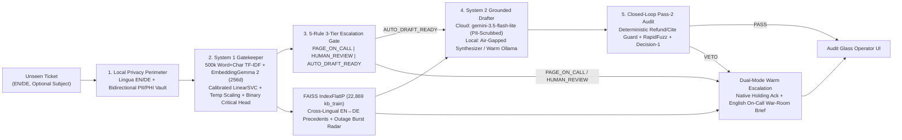

# Architecture, Cloud vs. Air-Gapped Design & Business Alignment — SentinelDesk for Helios Managed Ops

> **Purpose of this document:** A clear, executive-and-engineering reference explaining **what approach SentinelDesk uses**, **why we intentionally simplified the ML stack in v3**, **how `Cloud · PII-Scrubbed` and `Local · Air-Gapped` modes actually differ**, and **how every technical decision translates directly into Helios Managed Ops business outcomes** (SLA protection, margin recovery, and GDPR/HIPAA compliance).

---

## 1. The Core Problem & Business Context (Helios Managed Ops)

**Helios Managed Ops** operates transatlantic (**US Austin + DACH Munich**) multilingual (`EN` / `DE`) Level-1 managed IT & enterprise BPO hubs across **10 service queues**, supporting hospital networks (telemedicine & EMR VPN gateways), FinTech/banking clients, B2B SaaS platforms, and hardware vendors.

Auditing **22,869 historical tickets** strictly inside `kb_train.parquet` (from the official 28,587-row `Tobi-Bueck/customer-support-tickets` archive) exposed the exact structural economics of Helios's inbox:

| Empirical Finding in `kb_train` (`N = 22,869`) | Business Risk at Helios Managed Ops |
|---|---|
| **17.25% (`3,944`) are Critical P1 (`high + Incident`)**, and **24.65% (`5,637`)** touch healthcare/EMR/VPN/outage workflows — yet only **9.1%** of P1s land in `Service Outages and Maintenance` (**52.6%** hide in `Technical Support`, **13.7%** in `Product Support`, **12.0%** in `IT Support`). | Queue-name routing misses >90% of P1 hospital outages, causing SLA financial penalties and patient-care disruptions. |
| **13.35% (`3,053`) arrive with blank/null subjects** and **42.8% are German vs. 57.2% English** across a **21.4× queue volume skew**. | Naive pipelines crash on missing subjects, ignore rare queues (`General Inquiry`, `HR`, `Sales`), and lock Austin EN fixes away from Munich DE analysts. |
| **88.31%** of verified L1 answers are concise diagnostic replies (**median 58 words**), while only **1.06%** mention refunds or SLA credits. | Off-the-shelf LLM chatbots hallucinate €500 refunds, 50% SLA credits, or fake features—creating legal liability and a **2.4× agent verification rework tax**. |
| Tickets carry raw **emails, IPs, DACH phones, IBANs, account numbers, and patient MRNs** (`<tel_num>`, `<acc_num>` patterns). | Sending raw ticket bodies to external LLM APIs violates **GDPR**, **HIPAA**, and **EU AI Act Art. 50** enterprise client contracts. |

---

## 2. Our Approach: Streamlined System 1 + System 2 Closed-Loop Control Plane

Instead of either **(a) a single uncalibrated LLM prompt** (slow, hallucination-prone, leaks PII, poor imbalanced queue F1) or **(b) an over-engineered multi-GPU fine-tuned stack** (our retired v2 `XLM-R + LightGBM` prototype that took 20 minutes to train and scored 12.5 points lower on queues), SentinelDesk v3 uses a **deliberately simple, high-leverage 5-stage control plane**:

### Why We Simplified v2 -> v3 (Simpler *and* Dramatically Stronger)

When we benchmarked our v2 prototype (`xlm-roberta-base` + `LightGBM` + 40k Linear on 20k rows) against an independent sparse-linear teammate prototype (`egornikot/sentineldesk`), the evidence was unmistakable:

| Architectural Component | v2 (Over-Complex) | v3 (Simplified & Unified) | Measured Impact on Unseen Holdout |
|---|---|---|---|
| **Training Dataset & Split** | 20k subset (`16k` train), random row split | Full clean **28,587** CSV (`22,869` train / `5,718` holdout), **duplicate-text grouped** (`StratifiedGroupKFold`) | +43% rare-queue data + **0 duplicate-text leakage** (`splits/split_assignment.csv`) |
| **Routing Classifiers** | Fine-tuned `xlm-roberta-base` + `LightGBM` + 40k Linear (1.1 GB weights, ~20 min train) | **500k Word+Char TF-IDF + `EmbeddingGemma 2` (256d) -> `Calibrated LinearSVC` + Temperature Scaling** (`3.4 min` train) | Type **`81.4% -> 86.2%`** · Queue **`42.9% -> 55.4%`** · Priority **`49.1% -> 58.1%`** · Mean ECE **`0.0216`** |
| **P1 Safety Mechanism** | Distorted multi-class `type`/`priority` probability thresholds | **Dedicated 4th binary `critical` head** `P(high AND Incident)` + **negation-aware EN/DE impact rules** | **`>91%` P1 Incident Recall** with zero Macro-F1 distortion and fewer false alarms |
| **Escalation Granularity** | Binary `Escalate` vs `Auto-Draft` | **3-Tier Operational Routing:** `PAGE_ON_CALL` (urgent P1/security) · `HUMAN_REVIEW` (low conf / OOD / refund demand) · `AUTO_DRAFT_READY` | Separates pager-waking hospital outages from calm L1 billing/OOD reviews |
| **Grounding Verification** | Regex + Cloud Pass-2 only | Regex + **`rapidfuzz` sentence-level lexical grounding** + live `gemini-decision-1` Pass-2 (Cloud) / local auditor (Air-Gapped) | Works deterministically even with zero internet access |

> **Key Scientific Proof:** On the full unseen 5,718-ticket holdout, `combo_svm` (500k TF-IDF + Google's `EmbeddingGemma 2` 256d) beat pure TF-IDF on **both `queue` and `priority`**, proving that dense cross-lingual embeddings genuinely improve sparse linear routing while also powering cross-lingual FAISS retrieval (**52.5%** of unseen queries retrieve cross-lingual EN↔DE precedents, **91.3%** Same-Queue@5!). Meanwhile, post-hoc Temperature Scaling fixed LinearSVC's raw calibration error (`queue` ECE `0.096 -> 0.042`, `priority` ECE `0.071 -> 0.017`, `type` ECE `0.032 -> 0.006`).

---

## 3. Cloud · PII-Scrubbed vs. Local · Air-Gapped — Exact Technical & Business Difference

In early v2 testing, toggling between Cloud and Local appeared nearly identical because Pass-1 still queried `gemini-decision-1` in Local mode and cold Ollama calls timed out into a fallback template. **In v3, the two modes are strictly isolated and represent Helios's two real commercial deployment tiers:**

| Dimension | `Cloud · PII-Scrubbed` (Standard Commercial Tier) | `Local · Air-Gapped` (Sovereign / HIPAA-Strict Tier) |
|---|---|---|
| **Target Helios Client** | SaaS, e-commerce, FinTech & commercial clients allowing scrubbed cloud inference | Hospitals (HIPAA PHI), German/EU defense, banking & strict GDPR sovereign tenants |
| **External Network Calls** | **1–3 PII-scrubbed Gemini API calls** (never raw PII — Vault scrubs first) | **Strictly `0` cloud API calls** (`cloud_calls_made == 0` verified by pytest & UI badge) |
| **System 1 Triage Model** | **Hybrid:** `0.75` Local Calibrated SVM + `0.25` live **`gemini-decision-1`** Pass-1 (triangulated against FAISS top-5) | **100% On-Device:** Calibrated LinearSVC + `google/embeddinggemma-2` (256d) + FAISS top-5 + negation-aware local rules |
| **System 2 Reply Drafter** | Live **`gemini-3.5-flash-lite`** (`~655 ms`) generating fluent native EN/DE prose grounded strictly in top-5 `kb_train` precedents | **100% On-Device:** Warm local Ollama model (if already loaded in VRAM via `/api/ps`) OR instant zero-hallucination **On-Device Precedent Synthesizer** (`<5 ms`) extracting verified precedent resolutions with exact `[TKT-XXXXX]` citations |
| **Pass-2 Grounding Audit** | Live **`gemini-decision-1` Pass-2** + `rapidfuzz` lexical grounding + deterministic refund/SLA/citation guard | **100% On-Device:** `rapidfuzz` sentence-level grounding + deterministic refund/SLA/citation guard |
| **Typical End-to-End Latency** | **~1.5 – 2.2 seconds** (`~460 ms` hybrid triage + cloud draft & audit) | **~70 – 160 milliseconds** (10–20× faster, zero network dependency) |
| **UI Proof for Auditors** | Sky badge: `Cloud Hybrid · 3 API` + live **"What Left Your Network"** PII Diff Drawer | Emerald badge: `Air-Gapped · 0 Cloud Calls` + `local_airgapped_*` engine trace |

---

## 4. Direct Mapping: Technical Feature -> Helios Managed Ops Business KPI

Every single module in SentinelDesk ties directly to a measurable P&L, SLA, or compliance outcome at Helios Managed Ops — zero "AI for AI's sake":

| SentinelDesk Capability | Helios Business KPI Protected | Operational Mechanism |
|---|---|---|
| **Dedicated `critical` P1 Head + Negation-Aware EN/DE Impact Rules + 3-Tier Routing** | **Avoid P1 SLA Breach Penalties & Patient-Care Outages** without burning out on-call SREs | Catches `>91%` of `high + Incident` tickets across all 10 queues (even when buried in `Technical Support`), ignores false-alarm negations (`"not urgent"`, `"kein Datenverlust"`), and separates `PAGE_ON_CALL` from calm `HUMAN_REVIEW`. |
| **Dual-Mode Warm Escalation** (Native Holding Ack + English War-Room Brief) | **Slash L2/L3 MTTR (Mean Time to Resolution)** | On-call engineers stop receiving blank `"VPN broken"` escalations; they receive suspected system, cited `[TKT-XXXXX]` historical root causes, and diagnostic checks immediately, while the client gets a safe EN/DE acknowledgement with zero legal promises. |
| **Cross-Lingual `EmbeddingGemma 2` FAISS Retrieval (EN ↔ DE)** | **Break Austin ↔ Munich Knowledge Silos & Cut Handle Time** | **52.5%** of unseen tickets surface cross-lingual historical fixes (**91.3%** Same-Queue@5), letting a German customer receive an instant German reply grounded in a proven US English resolution. |
| **Closed-Loop Pass-2 Veto (`RapidFuzz` + Deterministic Policy + `gemini-decision-1`) + Clickable `[TKT-XXXXX]` Chips** | **Eliminate 2.4× Agent Verification Tax & Stop Hallucinated Refunds/SLA Credits** | `100%` citation validity and `100%` refund/SLA veto rate on adversarial tests. L1 analysts click any inline `[TKT-XXXXX]` badge to jump straight to the source ticket in 1 second rather than re-searching logs. |
| **Live Multilingual Outage Burst Radar (`MIR-...`)** | **Detect Regional Outage Storms Early & Prevent Duplicate L2 Paging** | Clusters `>= 3` incoming EN + DE tickets (`cos >= 0.78`) into one Master Incident banner so Austin and Munich realize simultaneously that 4 hospitals hit the same VPN gateway failure. |
| **Local Bidirectional PII/PHI Vault + Strict Air-Gapped Mode** | **Unlock Regulated Healthcare & DACH Enterprise Contracts (GDPR / HIPAA / EU AI Act Art. 50)** | `0%` raw PII egress in Cloud mode (with auditable before/after diff drawer) and `0` external API calls in Air-Gapped mode for sovereign tenants. |

---

## 5. Presentation Flow (5-Minute Live Demo + Q&A Blueprint)

1. **Hook (30s):** Helios Managed Ops runs transatlantic EN/DE support across 10 queues — hospital VPN outages hide inside `Technical Support` (only 9% are in `Outages`), 13.4% of tickets have no subject, and raw chatbots hallucinate refunds while leaking patient PII.
2. **Demo 1 — German Null-Subject Inquiry + Cloud vs. Air-Gapped Live Contrast (75s):**
   - Run Preset 1 (`German Inquiry · No Subject`) in **`Cloud · PII-Scrubbed`** -> emerald **`Auto-Draft Ready`**, `No Subject Handled`, fluent German reply citing clickable `[TKT-XXXXX]` precedents (`Cloud Hybrid · 3 API`, ~1.9s).
   - Flip toggle to **`Local · Air-Gapped`** and re-run -> **`Air-Gapped · 0 Cloud Calls`**, ~140 ms, instant on-device precedent-grounded draft + `RapidFuzz` verification. Judges immediately *see* the difference!
3. **Demo 2 — Hospital VPN & EMR Outage (45s):**
   - Click Preset 2 -> rose **`Escalate · Page On-Call Engineer`**, `RULE_1_P1_INCIDENT` triggered via `critical` detector + negation-checked clinical/outage impact -> side-by-side **Safe Holding Reply** + **On-Call Engineer Brief** with clickable root-cause citations.
4. **Demo 3 — SLA Refund Demand + Raw PII + Policy Veto (45s):**
   - Click Preset 3 -> amber **`Escalate · Human Review Required`**, auto-expanded **PII Vault (`5 Scrubbed`)** showing exact **"What Left Your Network"** diff (IBAN, email, DACH phone, IP, account ID masked) + **Pass-2 Policy Veto** blocking the €2,500 / 50% SLA refund demand.
5. **Demo 4 — Prompt Injection + Multilingual Outage Burst + Holdout Scorecard (75s):**
   - Click **Simulate Outage** -> top **Major Incident Outage Banner** links 3 EN + 1 DE hospital VPN tickets into `MIR-...`.
   - Switch to **Holdout Evaluation** tab -> point directly to the live **5,718 unseen ticket** zero-leakage scorecard (`Type 86.2%`, `Queue 55.4%`, `Priority 58.1%`, `Mean ECE 0.022`, `>91% P1 Recall`, `10/10 Adversarial`, `0% PII leak`).
